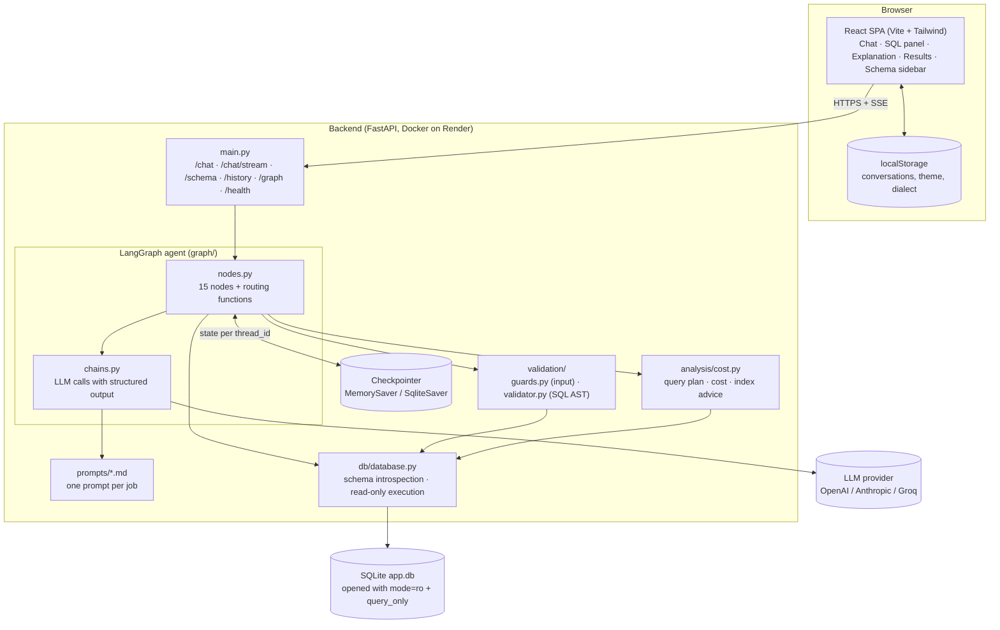
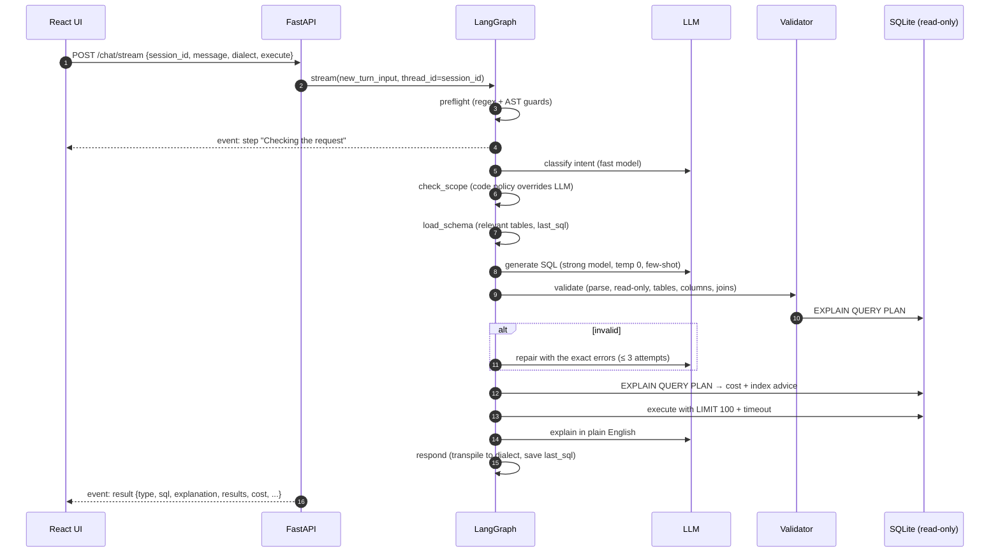

# Architecture

## System overview

## Components

| Component | File(s) | Responsibility |
|---|---|---|
| **Frontend** | `frontend/src` | Chat UI, per-step progress, SQL panel (highlighting, copy, download), explanation, validation and cost insights, results table with CSV export, schema explorer, dark mode, conversation list |
| **API** | `backend/app/main.py` | Request validation (Pydantic), CORS, SSE streaming, error mapping, graph lifecycle |
| **Graph** | `backend/app/graph/builder.py` | Wires nodes and edges, compiles the graph with a checkpointer |
| **Nodes** | `backend/app/graph/nodes.py` | One function per step. All safety decisions live here, in code |
| **Chains** | `backend/app/graph/chains.py` | Every LLM call; returns Pydantic objects via `with_structured_output` |
| **Prompts** | `backend/app/prompts/*.md` | System, intent, generate, few-shot, repair, optimize, debug, explain |
| **Input guards** | `backend/app/validation/guards.py` | Prompt-injection, destructive and off-topic prefilters; SQL extraction |
| **Validator** | `backend/app/validation/validator.py` | sqlglot AST checks + SQLite `EXPLAIN QUERY PLAN`; dialect transpiling |
| **Cost analysis** | `backend/app/analysis/cost.py` | Full scan vs index search, estimated rows read, index recommendations |
| **Database** | `backend/app/db/` | Schema DDL, deterministic seed, read-only connection, timeout and row cap |
| **LLM factory** | `backend/app/llm.py` | Provider switch (OpenAI / Anthropic / Groq), fast vs strong model |

## Request lifecycle (one chat turn)

## Key design decisions

1. **Code enforces safety, the LLM only proposes.** The model never touches the database.
   Read-only is guaranteed by three independent layers: AST validation, a `mode=ro`
   connection, and `PRAGMA query_only`.
2. **The graph has explicit nodes for each job**, not one big prompt, so each step can be
   tested, traced and streamed to the UI on its own.
3. **Structured output everywhere.** Each chain returns a Pydantic model (`IntentResult`,
   `SQLResult`, `OptimizeResult`, `DebugResult`, `ExplanationResult`), so there is no
   free-text parsing.
4. **The schema is introspected, not hard-coded.** `load_schema()` reads tables, columns,
   foreign keys, indexes, row counts and sample rows from SQLite, so the provided schema can
   be swapped in without code changes.
5. **Two model tiers.** A cheap model classifies intent; a strong model writes and fixes SQL.
6. **Testable without an API key.** Nodes call `chains.<fn>` through the module, so tests
   replace them with a scripted fake and exercise the real graph, validator and database.
7. **Scaling path.** `select_relevant_tables()` sends the whole schema when it is small
   (≤ 25 tables). Beyond that it retrieves relevant tables plus their foreign-key
   neighbours. Swapping the keyword score for embeddings changes no other code.
