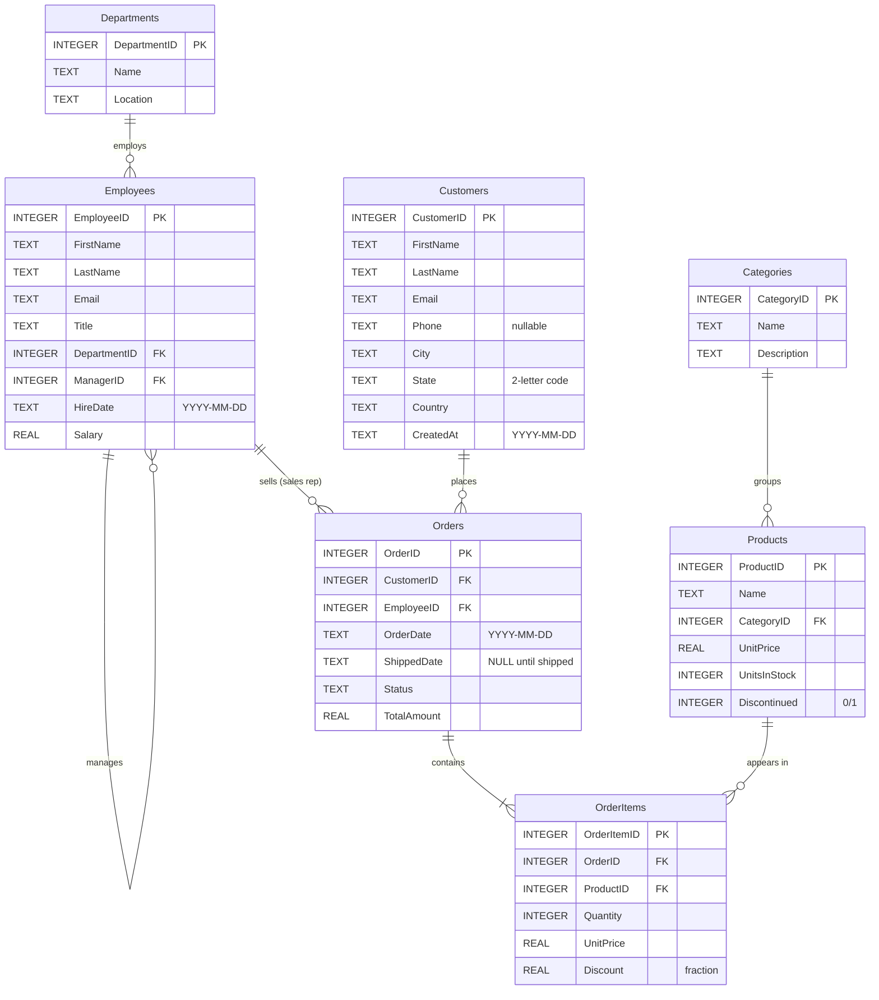

# Sample database schema

A small e-commerce + HR database in SQLite: 7 tables with realistic, deterministic seed
data (`random.Random(42)`), so results are the same on every machine.

- DDL: [`backend/app/db/schema.sql`](../backend/app/db/schema.sql)
- Seed script: [`backend/app/db/seed.py`](../backend/app/db/seed.py) → `python -m app.db.seed [--force]`
- The schema is also served live at `GET /schema` and shown in the app's sidebar.

## ER diagram

## Tables

| Table | Rows | Notes |
|---|---|---|
| `Departments` | 6 | Sales, Engineering, Marketing, Support, Finance, HR |
| `Employees` | 32 | Hire dates 2018 to mid-2026 (9 hired on or after 2024-01-01). `ManagerID` is a self-reference |
| `Customers` | 80 | 16 US cities; `State` is a 2-letter code (17 in `'CA'`). ~15% have a NULL `Phone`. 5 customers have never ordered |
| `Categories` | 6 | Electronics, Books, Home, Sports, Toys, Grocery |
| `Products` | 30 | ~10% discontinued. 3 products have never been ordered |
| `Orders` | 500 | 2023 to Sept 2026; `Status` ∈ Pending, Shipped, Delivered, Cancelled; `ShippedDate` NULL until shipped |
| `OrderItems` | ~1,280 | 1–4 lines per order with quantity, price and discount |

## Design choices that make the demo meaningful

- **Data built for the brief's examples**: employees hired after Jan 2024, customers in California, NULL phone numbers (for the `= NULL` debug case), never-ordered products and customers (LEFT JOIN anti-join), cancelled orders (revenue filters).
- **Few indexes on purpose.** Only primary keys and `Employees(DepartmentID)` are indexed, so the optimizer has real recommendations to make (`Orders(CustomerID)`, `Orders(Status)`, `Customers(State)`, …) and can show it doesn't recommend an index that already exists.
- **Declared foreign keys** are what the join validator checks against.

## Swapping in the provided schema

The agent introspects the database at startup (tables, columns, types, PKs, FKs, indexes,
row counts, sample rows), so nothing in the agent code is tied to these tables.

1. Replace `backend/app/db/schema.sql` with the provided DDL (SQLite syntax; convert with `sqlglot.transpile(ddl, read="postgres", write="sqlite")` if needed).
2. Update `seed.py` to insert the provided sample data, or point `DATABASE_PATH` in `.env` at an existing SQLite file.
3. Update `backend/app/prompts/few_shot.md` with 4–6 examples for the new tables (the biggest accuracy lever).
4. Update the example prompts in `backend/app/main.py` (`EXAMPLE_PROMPTS`) and `backend/eval/cases.json`.
5. Run `python -m app.db.seed --force` and `pytest`. Some tests reference sample tables by name and will need updating.
