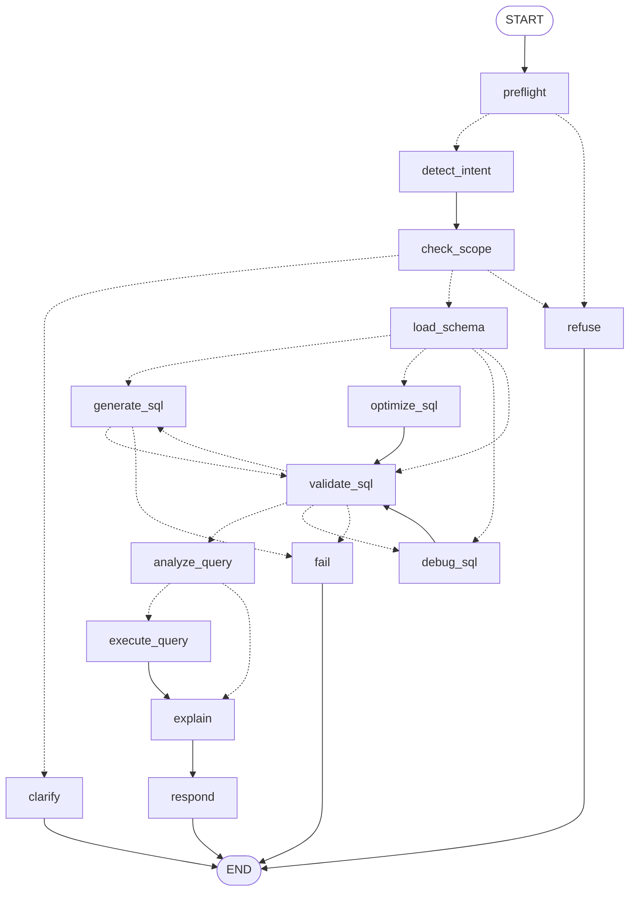

# LangGraph workflow

The agent is a single `StateGraph` (`backend/app/graph/builder.py`). A typed state object
flows through nodes; fixed edges and conditional edges decide what runs next; a
checkpointer saves the state after every step, keyed by the conversation's `thread_id`.

The diagram below is generated from the compiled graph (`python -m scripts.export_graph`,
also served live at `GET /graph`). Dotted arrows are conditional edges.



It follows the expected workflow from the brief, extended with a code-level preflight,
three task branches, a retry loop and three graceful exits:

| Brief | This graph |
|---|---|
| Intent Detection | `preflight` (code) + `detect_intent` (LLM) |
| Scope Validation → Reject | `check_scope` → `refuse` / `clarify` |
| Schema Retrieval | `load_schema` |
| SQL Generation | `generate_sql` / `optimize_sql` / `debug_sql` |
| SQL Validation | `validate_sql` (+ retry loop) |
| SQL Optimization | `analyze_query` (cost + index advice for **every** query; LLM rewrite for optimize requests) |
| (Optional) Execute Query | `execute_query` (toggle in the UI) |
| Generate Explanation | `explain` |
| Return Response | `respond` |

---

## State

Defined in `backend/app/graph/state.py`.

| Field | Lifetime | Meaning |
|---|---|---|
| `question`, `dialect`, `execute` | turn input | The user's message and options |
| `messages` | **conversation** | Chat turns; reducer `add_messages` **appends** instead of overwriting |
| `last_sql`, `last_question` | **conversation** | The last successfully validated query: what a follow-up modifies |
| `forced_intent`, `preflight_reason` | turn | Set by code-level guards; overrides the LLM |
| `user_sql` | turn | SQL extracted from the message (code fence or inline), converted to SQLite |
| `intent` | turn | `generate · followup · optimize · debug · explain · clarify · destructive · out_of_scope` |
| `tables`, `schema_prompt` | turn | Retrieved tables and their DDL + sample rows |
| `sql` | turn | Current candidate SQL |
| `errors`, `error_history`, `warnings`, `retries` | turn | Validation output and retry counter |
| `cost`, `optimization`, `debug` | turn | Analysis payloads for the UI |
| `results`, `execution_error` | turn | Query output |
| `explanation` | turn | `{summary, details}` |
| `response` | turn | Final payload returned by the API |

Every turn starts with `new_turn_input()`, which resets all per-turn fields while the
checkpointer keeps `messages`, `last_sql` and `last_question`.

---

## Nodes, step by step

| # | Node | Type | What it does |
|---|---|---|---|
| 1 | `preflight` | code | Looks for prompt-injection phrases, destructive requests (regex + parsing any pasted SQL with sqlglot) and obvious off-topic questions. Extracts pasted SQL. Appends the user message to `messages`. |
| 2 | `detect_intent` | LLM (fast) | Classifies the message using the schema, the previous question and SQL, and recent history. Returns `IntentResult` (intent, clarification question, safe alternative). |
| 3 | `check_scope` | code | Policy on top of the LLM: a code-detected destructive request stays destructive whatever the LLM said; optimize/debug/explain without SQL uses `last_sql` ("explain that") or asks for it; a follow-up with no previous query becomes a fresh generate. |
| 4 | `load_schema` | code | Picks the tables to send (all of them for small schemas; BM25-ranked top 8 + their foreign-key neighbours for large ones) and builds the DDL prompt. For optimize/debug/explain it seeds `sql` with the user's query. |
| 5a | `generate_sql` | LLM (strong) | First pass: generate (with the previous query when it's a follow-up). Retry pass: **repair**, given the failing SQL and the validator's exact errors. |
| 5b | `optimize_sql` | LLM (strong) | Gets the original query's `EXPLAIN QUERY PLAN`; returns optimized SQL, changes, removed joins and index suggestions. |
| 5c | `debug_sql` | code + LLM | Runs the validator on the user's SQL first, then sends those concrete errors to the model, which returns issues (problem / why / fix) and corrected SQL. |
| 6 | `validate_sql` | code | Every SQL string passes here (see [GUARDRAILS.md](GUARDRAILS.md)). On failure it increments `retries`; an "explain" of broken SQL is switched to "debug". |
| 7 | `analyze_query` | code | Cost estimate from the query plan and row counts, plus index recommendations. |
| 8 | `execute_query` | code | Adds `LIMIT 100` when missing and runs on the read-only connection with a timeout. Execution errors are reported, not raised. |
| 9 | `explain` | LLM (strong) | Plain-English summary plus 2–5 bullets, informed by the row count and first rows. |
| 10 | `respond` | code | Transpiles to the requested dialect, builds the response, stores `last_sql`/`last_question`, appends the assistant turn. |
| – | `refuse` | code | Fixed messages: out-of-scope (the brief's exact wording), destructive (with a read-only alternative), injection. |
| – | `clarify` | code | Returns the classifier's clarifying question. |
| – | `fail` | code | After 3 invalid attempts, or when the model says the schema can't answer the request. Returns the errors seen. |

## Conditional edges

| From | Function | Routes |
|---|---|---|
| `preflight` | `route_after_preflight` | injection / off-topic → `refuse` (no LLM call at all); otherwise → `detect_intent` |
| `check_scope` | `route_by_intent` | out_of_scope, destructive → `refuse`; clarify → `clarify`; else → `load_schema` |
| `load_schema` | `route_by_task` | generate, followup → `generate_sql`; optimize → `optimize_sql`; debug → `debug_sql`; explain → `validate_sql` (skips generation) |
| `generate_sql` | `route_after_generation` | empty SQL ("can't be answered from this schema") → `fail`; else → `validate_sql` |
| `validate_sql` | `route_after_validation` | valid → `analyze_query`; explain-turned-debug → `debug_sql`; `retries < 3` → `generate_sql` (**retry loop**); else → `fail` |
| `analyze_query` | `route_after_analysis` | `execute` on → `execute_query`; off → `explain` |

## The retry loop

```
generate_sql ──► validate_sql ──(errors, retries < 3)──► generate_sql (repair prompt + exact errors)
                      │
                      └──(errors, retries = 3)──► fail
```

The repair prompt includes the exact validator output, for example
`Column 'HireDt' does not exist in the referenced tables. Did you mean 'HireDate'?`.
Specific errors are what make self-correction work. The `retries` count is returned to
the UI ("self-corrected 1×").

## Conversation memory

- The frontend creates a `session_id` (`crypto.randomUUID()`) per conversation and sends it with every message.
- The API passes it as `thread_id` (prefixed with the user id when signed in, so one account can't read another's memory). The checkpointer restores that conversation's state before the turn: `PostgresSaver` when `DATABASE_URL` is set (survives restarts), `SqliteSaver` when `CHECKPOINT_DB` is set, otherwise `MemorySaver`.
- If the server has no memory of the conversation (in-memory storage after a restart), the browser's copy of the last valid query is used instead, but only after it passes the validator again.
- `last_sql` is written only after a query passes validation, so a follow-up always builds on a known-good query.
- For a `followup`, the generation prompt contains the previous question and query, with the instruction *"Modify the previous query… keep its existing filters, joins and columns unless the user asks to change them"*.
- Only the last `HISTORY_TURNS` (6) turns go to the classifier, which keeps cost and confusion low.

Demo chain: `Show all customers` → `Only those from California` (adds `WHERE State = 'CA'`) →
`Sorted by last name` (adds `ORDER BY`, keeps the filter) → `How many are there?` (wraps it in `COUNT(*)`).

## Streaming

`POST /chat/stream` runs `graph.stream(..., stream_mode=["updates", "custom"])` and sends
one server-sent event per node (`event: step`), then the explanation text as it is written
(`event: token`, sent from the `explain` node through LangGraph's stream writer), then the
final payload (`event: result`). The UI shows each step live, then the explanation typing out.
Only the explanation streams: the SQL is shown once it has passed validation.
`POST /chat` runs the same generator and returns only the result.
